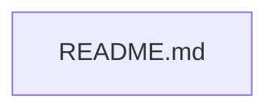

# Grok-Helix-Monitoring

A repository for monitoring Grok Helix environments.

<!-- SCREENSHOT PLACEHOLDER: hero image of the main application interface -->
_Screenshot coming soon._

## Features

- Initializes the repository structure.
- Contains foundational project documentation.
- Prepares the project for future monitoring integration.
- Tracks project progress via issue management.

## Architecture

The architecture currently consists of a single root documentation file.
Future components and modules will be detailed here as they are added.

## Quick start

There are no prerequisites, installation, run, or test commands available
at this time.

## Configuration

| Name | Purpose | Default |
| ---- | ------- | ------- |
| None | N/A     | N/A     |

## Screenshots

<!-- SCREENSHOT PLACEHOLDER: screenshot of the monitoring dashboard -->
_Screenshot coming soon._

## Roadmap

See issues.

## License & credits

No license is currently specified.
